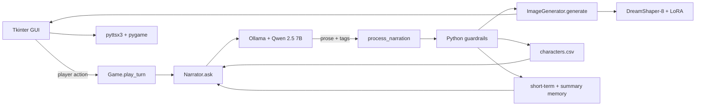

# Puca — A Dark Fantasy Interactive Story (v2)

> **18+ content warning.** Puca is an adult dark-fantasy prototype. It can generate graphic violence, gore, nudity, and sexual content. It is not suitable for minors. You are responsible for what you generate and where you run it.

> **Unrestricted models warning.** v2 was tested with an abliterated (uncensored) Qwen 2.5 7B language model and a Stable Diffusion pipeline with the safety checker disabled. I did not create these models. They can produce explicit, violent, or otherwise harmful output. Use extreme caution. Do not expose this to the public internet without your own content filters, rate limits, logging, and abuse handling.

**Status:** experimental prototype — archived learning project. Not production-ready. No hosted demo.

Puca is a locally run dark-fantasy RPG. You type an action; a local LLM narrates the world's response; Stable Diffusion draws the scene; pyttsx3 reads the narration aloud; pygame loops the music. Python owns the state — characters, location, combat flags, image composition — and the LLM only proposes narration and structured tags. The design rule is **the LLM proposes, Python disposes.**

## Version guide

| Version | Branch | Status | Platform |
| --- | --- | --- | --- |
| **v1** | [`v1`](https://github.com/glennypenny/puca_fantasy_tale/tree/v1) | Legacy — frozen | Windows 11 |
| **v2** | [`v2`](https://github.com/glennypenny/puca_fantasy_tale/tree/v2) | Experimental prototype — archived | Pop!_OS 24.04 (Linux) |
| **v3** | *coming soon* | Planned | TBD |

`main` is the landing page. Each version lives on its own branch.

## What v2 is (and isn't)

v2 is a modular rewrite of the v1 prototype. It is **not** a finished game and it is **not** a public demo.

What it does:

- Runs entirely locally: Ollama for the LLM, Hugging Face Diffusers for images, pyttsx3 for speech, pygame for music.
- Tracks NPCs in a CSV-backed registry with trust, desire, and fear values.
- Generates a 512×512 pixel-art image after every turn.
- Keeps short-term and summarized long-term memory.
- Enforces a set of rules in Python instead of hoping the model remembers them.

What it doesn't do:

- It doesn't persist characters across sessions. `characters.csv` is deleted on exit by design.
- It doesn't have a web UI, multiplayer, save/load slots, tests, or a licence for the models.
- It doesn't run on Windows as-is. The GUI and paths are Linux-specific; a Windows port would need changes in `gui.py` and the hard-coded paths.

## What changed from v1

| Area | v1 (`my_version_of_kawa.py`) | v2 (`Game/Game_linux/`) |
| --- | --- | --- |
| Code | One ~449-line file with three classes | Eight modules split by responsibility |
| LLM | Mistral via Ollama, 60-second timeout | Qwen2.5 7B abliterated on CPU, 300-second timeout, `keep_alive` |
| Images | SD 1.5 + old pixel LoRA, 30 steps | DreamShaper-8 + `glen_lora_v2`, DEIS, 25 steps |
| GUI | 800×700 Tkinter, single column | 2560×1440 two-column dark theme |
| Voice | Windows SAPI via `win32com` | `pyttsx3` (cross-platform) |
| Music | pygame loop | pygame loop |
| Character state | none structured | CSV registry, 12 fields, trust/desire/fear |
| Memory | last 8 events + 500-char scene context | ~600-char short-term + 3-turn summary + location handoff |
| Rules | prompt-only | ~20 Python guardrails |
| Story | 5-turn arc with a spirit score | open-ended, no HP/spirit score |
| Platform | Windows 11 | Linux (tested on Pop!_OS 24.04) |

## How it works



A turn:

1. `gui.py` captures the action and disables the input.
2. `game.py` parses movement, enriches the character sheet, and calls `Narrator.ask()`.
3. `narrator.py` sends a single prompt to Ollama and returns the raw text.
4. `narration.py` extracts `[location:]`, `[characters:]`, `[new_character:]`, `[npc_update:]`, `[image_prompt:]`, and `[player_death]`.
5. `game.py` applies the guardrails, updates characters/location/memory, and builds the final image prompt.
6. `image_generator.py` generates and saves the image.
7. `gui.py` updates the text, image, action buttons, and speaks the narration.

## Project structure

```
puca_fantasy_tale/
├── README.md
├── requirements.txt
├── .gitignore
├── .gitattributes
└── Game/
    └── Game_linux/
        ├── main.py              # entry point
        ├── gui.py               # Tkinter window, TTS, music
        ├── game.py              # turn loop, state, guardrails
        ├── narrator.py          # Ollama HTTP client
        ├── image_generator.py   # DreamShaper + LoRA
        ├── narration.py         # tag parser
        ├── prompts.py           # system + summary prompts
        ├── keywords.py          # word lists and matcher
        ├── newsynthwave.wav     # music
        └── loras/
            └── glen_lora_v2/    # LoRA weights
```

`characters.csv` and `saved_images/` are generated at runtime and are not committed.

## Requirements

- Linux. Tested on Pop!_OS 24.04 LTS.
- Python 3.12.
- NVIDIA GPU with 8 GB+ VRAM for Stable Diffusion.
- ~10 GB free disk for the models.
- Ollama.
- Internet for the first run (DreamShaper download).
- `python3-tk`, `espeak-ng`, and `git-lfs` (the LoRA is stored with LFS).

Windows is not supported out of the box. The code uses Linux-style absolute paths and a 2560×1440 Tkinter layout; a Windows port would need GUI and path changes.

## Installation

1. Clone the branch:

```bash
git clone --branch v2 https://github.com/glennypenny/puca_fantasy_tale.git
cd puca_fantasy_tale
```

2. Install Git LFS and fetch the LoRA:

```bash
sudo apt install git-lfs
git lfs install
git lfs pull
```

3. Create a virtual environment:

```bash
python3 -m venv .venv
source .venv/bin/activate
python -m pip install --upgrade pip
```

4. Install PyTorch with CUDA 13.0 (tested):

```bash
pip install torch torchvision --index-url https://download.pytorch.org/whl/cu130
```

5. Install the rest:

```bash
pip install -r requirements.txt
```

6. Install the system packages for Tkinter and speech:

```bash
sudo apt install python3-tk espeak-ng
```

7. Pull the LLM:

```bash
ollama pull hf.co/richardyoung/Qwen2.5-7B-Instruct-abliterated-GGUF:latest
```

8. Make sure Ollama is running:

```bash
ollama serve
```

If it is already running as a service, skip this.

9. Edit the four hard-coded paths. See [Configuration](#configuration).

10. Run:

```bash
cd Game/Game_linux
python main.py
```

The first run downloads DreamShaper-8 into `~/.cache/huggingface` (several GB) and loads the LoRA. The first image is slow.

## Configuration

The code uses absolute paths. Change these four values to match your machine:

| What | File | Line | Default | Set it to |
| --- | --- | --- | --- | --- |
| Character CSV | `game.py` | 22 | `/home/glen/Documents/fantasy_game/Game/Game_linux/characters.csv` | `<repo>/Game/Game_linux/characters.csv` |
| LoRA folder | `game.py` | 45 | `/home/glen/Documents/fantasy_game/Models/glen_lora_v2/` | `<repo>/Game/Game_linux/loras/glen_lora_v2/` |
| Saved images | `image_generator.py` | 7 | `/home/glen/Documents/fantasy_game/Game/Game_linux/saved_images` | `<repo>/Game/Game_linux/saved_images` |
| Saved images | `gui.py` | 12 | `/home/glen/Documents/fantasy_game/Game/Game_linux/saved_images` | `<repo>/Game/Game_linux/saved_images` |
| Music | `gui.py` | 58 | `"newsynthwave.wav"` | `"newsynthwave.wav"` if you launch from `Game/Game_linux`, or an absolute path |

Use absolute paths. A leading `~` is not expanded inside Python strings.

## Running and controls

```bash
cd Game/Game_linux
python main.py
```

- Click **Play**.
- Enter your name and starting location in the dialogs.
- Type an action and press **Enter**, or click one of the three generated action buttons.
- Type `quit` or `exit`, or close the window, to end the session.

On exit, the game deletes `characters.csv`. That is intentional: v2 keeps character state for one session only.

## Character CSV

`characters.csv` is created when the first NPC is saved. It has 12 columns:

| Column | Meaning |
| --- | --- |
| `name` | NPC name |
| `race` | Race |
| `gender` | Gender |
| `appearance` | Physical description |
| `current_outfit` | Current clothing |
| `outfit_state` | `worn`, `damaged`, or `removed` |
| `personality` | Personality summary |
| `trust_level` | 0–100 |
| `desire_level` | 0–100 |
| `fear_level` | 0–100 |
| `current_location` | Last known location |
| `last_seen_turn` | Turn number |

Trust/desire/fear are converted into phrases the LLM can act on (“openly hostile”, “deeply loyal”, etc.).

## Guardrails

The Python layer enforces, among other things:

- Whole-word keyword matching for movement, combat, gore, death, leaving, solo actions, and conversation.
- A 6-turn gore timer; gore is stripped from image prompts when the timer expires.
- Composition overrides: empty-room shots, portrait/close-up checks, combat action shots, object-focus shots, and no-character enforcement.
- A solo-spawn blocker: no new NPC during movement, combat, or solo actions unless the player explicitly searches.
- Placeholder-name and player-as-NPC blocking.
- A repetition guard: if the new narration overlaps the previous turn by more than 60%, it regenerates once.
- Clothing enforcement: the CSV outfit overrides the LLM’s clothing description in the image prompt; stripping is only allowed when the player explicitly asks.
- Absent-character stripping from image prompts.
- Location fuzzy-matching to avoid accidental scene resets.
- A death-keyword fallback and `[player_death]` handling.
- NPC follow-prevention when the player leaves.
- Hallucinated-character filtering against the CSV.
- A 1-in-10 random event roll (ambush, quest, or omen).

## Troubleshooting

| Symptom | Likely cause | Fix |
| --- | --- | --- |
| `[Connection Error]` | Ollama is not running | `ollama serve`; check `ollama list` |
| `[Ollama Error: 404]` | Model tag is wrong | `ollama pull hf.co/richardyoung/Qwen2.5-7B-Instruct-abliterated-GGUF:latest` |
| CUDA out of memory | Another GPU process is running | Close it; lower resolution in `image_generator.py` |
| `torch.cuda.is_available()` is `False` | CPU-only torch or no driver | Reinstall torch from the CUDA index; check `nvidia-smi` |
| Image generation is very slow | Torch is CPU-only or the model is loading | Check CUDA; the first run is always slow |
| No voice | `espeak-ng` missing | `sudo apt install espeak-ng` |
| No music | `newsynthwave.wav` is not in the working directory | Copy it to `Game/Game_linux/` or set an absolute path |
| LoRA file is a 132-byte pointer | Git LFS did not fetch it | `git lfs install && git lfs pull` |
| `ModuleNotFoundError: No module named 'tkinter'` | `python3-tk` missing | `sudo apt install python3-tk` |
| Characters vanish on restart | The CSV is deleted on exit | Intentional; see Known limitations |

## Known limitations

- **It’s a prototype.** There are no tests, no type hints, no packaging, and no automated setup.
- **Session-only memory.** `characters.csv` is deleted on exit; there is no save/load or session isolation.
- **The 7B model is the ceiling.** Dialogue can loop, tags occasionally leak, and image consistency is roughly 70–80% across long turns.
- **Portrait spam is only partly mitigated.** The composition overrides help, but the model still over-focuses on faces.
- **No content filter.** The LLM is abliterated and the SD safety checker is disabled. This is not safe for public deployment.
- **No HP/spirit system.** Death is a single `[player_death]` flag plus keyword fallbacks, not a full combat system.
- **Hard-coded paths.** The four paths in the Configuration table must be edited.
- **CPU-bound LLM.** The 7B model runs on CPU (`num_gpu: 0`) to leave VRAM for Stable Diffusion; expect slow turns.
- **No Windows support.** The GUI and paths are Linux-specific.

## Why this is archived / what v3 would need

This was a learning project. It proved the architecture — Python owns state, the LLM narrates — but the model quality and safety story aren’t good enough for a public demo. v3 is planned as a fresh build with:

- A fine-tuned model instead of a general 7B.
- An `AIBouncer` class from day one.
- SFW content filtering.
- In-memory session state instead of a CSV file.
- A proper configuration layer instead of hard-coded paths.
- Tests and a reproducible setup.

## Credits and licences

- **Game design, lore, code, and music:** Glen Salmon.
- **v2 LoRA:** trained by Glen Salmon on a private dataset of ~200 pixel-art images generated with Midjourney.
- **Models:** DreamShaper-8 by Lykon; Qwen2.5-7B-Instruct-abliterated by Richard Young; Stable Diffusion 1.5 by RunwayML.
- **Libraries:** Ollama, Hugging Face Diffusers, PEFT, PyTorch, Tkinter, pyttsx3, pygame.

All rights reserved for the game code, lore, music, and LoRA. The model weights remain under their respective licences. Midjourney-generated training images remain subject to Midjourney’s terms. I did not create the base models and cannot grant rights to them.

## Related branches

- [`main`](https://github.com/glennypenny/puca_fantasy_tale) — landing page.
- [`v1`](https://github.com/glennypenny/puca_fantasy_tale/tree/v1) — original Windows prototype.
- [`v2`](https://github.com/glennypenny/puca_fantasy_tale/tree/v2) — this branch.
